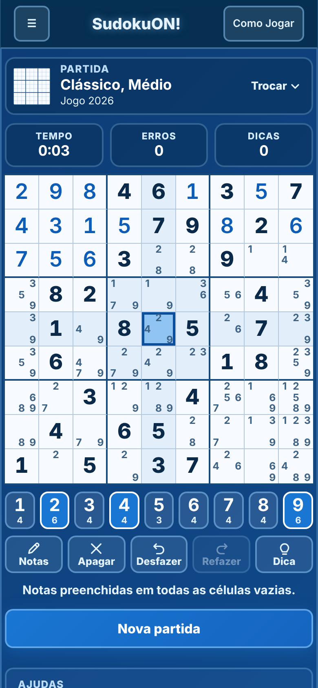
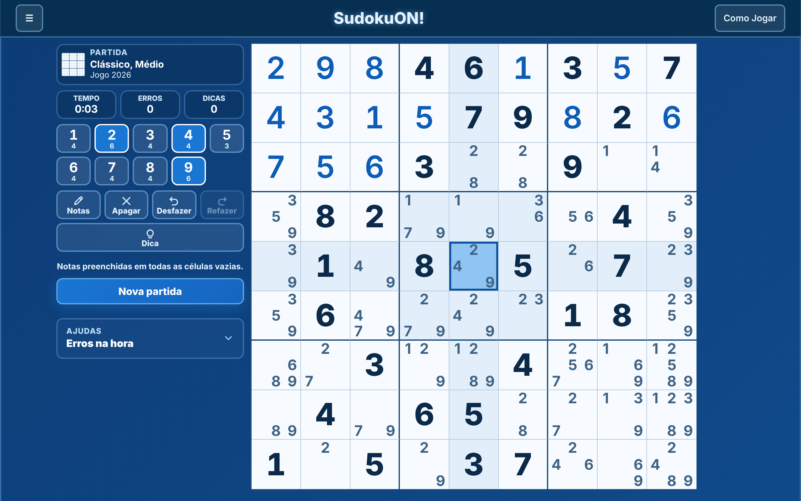

# SudokuON!

Sudoku em português do Brasil, com quatro variantes, seis níveis, notas, dicas explicadas passo a passo e jogo do dia. Toda partida tem uma única solução, e o nível dela é a técnica mais difícil que ela exige. Funciona no navegador ou instalado como app, inclusive sem internet.

**Jogue:** https://sudokuon.netlify.app/ · **Mais jogos:** https://speccygames.netlify.app/

  
  &nbsp;&nbsp;
  

## Como jogar

1. Escolha a variante e o nível no botão da partida, no alto da tela, e toque em **Jogar**.
2. Toque numa casa vazia e depois no número que você quer colocar. Cada linha, coluna e bloco precisa ter todos os números uma única vez.
3. Use **Notas** para anotar os candidatos de uma casa. **Desfazer** e **Refazer** não têm limite.
4. Travou? Peça uma **dica**. Ela vem em duas etapas: primeiro só onde olhar e o nome da técnica, depois o raciocínio completo, com a opção de aplicar a jogada.
5. Acertando a última casa, a partida termina e entra nas estatísticas.

O botão **Como Jogar** do topo explica o site, as regras e cada técnica, com um exemplo real de cada uma. Na primeira visita ele abre sozinho.

## Variantes

| Variante | Tamanho | Observação |
|---|---|---|
| Clássico | 9×9 | O Sudoku de sempre |
| Diagonal (X) | 9×9 | As duas diagonais também não repetem número |
| Mini 6×6 | 6×6 | Blocos de 2×3, níveis 1 e 2 |
| Mini 4×4 | 4×4 | Blocos de 2×2, só o nível 1 |

## Níveis

| Nível | Técnicas que a partida pode exigir |
|---|---|
| 1 Iniciante | único candidato |
| 2 Fácil | único lugar |
| 3 Médio | apontando, reivindicação, par exposto |
| 4 Difícil | par e trio escondidos, trio exposto, X-Wing |
| 5 Especialista | Swordfish, XY-Wing, XYZ-Wing |
| 6 Mestre | contradição |

## Recursos

- Todas as partidas têm solução única, e o nível é conferido por um solucionador que raciocina como uma pessoa
- Número do jogo: a mesma variante, o mesmo nível e o mesmo número dão sempre a mesma grade, em qualquer aparelho
- **Jogo do dia**, igual para todo mundo, com contagem de dias seguidos nas estatísticas
- Ajudas à sua escolha: mostrar erros na hora ou só ao verificar, marcar números repetidos, realçar números iguais, limpar notas sozinho
- Pausa que esconde o tabuleiro
- Teclado completo no computador
- Partida salva automaticamente: feche a aba e continue depois
- Menu lateral com atalho **Outros Jogos**, **estatísticas** e **configurações** (som, vibração, tremor da tela, modo escuro, reduzir animações)
- Modo escuro e "reduzir animações" (seguem o sistema por padrão)
- Instala no celular ou no computador e funciona offline

## Instalando como app

- **Chrome e Edge (computador e Android):** botão **Instalar app** no menu ☰ ou o ícone na barra de endereço.
- **Safari (iPhone e iPad):** Compartilhar, depois *Adicionar à Tela de Início*.

## Créditos

Os ícones usam a fonte DejaVu Sans Bold, que parte da Bitstream Vera (© 2003 Bitstream, Inc., licença que permite uso gratuito, inclusive comercial; as mudanças do DejaVu são de domínio público). Fonte: https://dejavu-fonts.github.io/.

## Família ON!

SudokuON! é o primeiro jogo de lógica da família e segue a base visual do **DiciON!**. Todos os jogos ficam em https://speccygames.netlify.app/.

---

Feito por Christian ([@Christian5910](https://github.com/Christian5910)).
